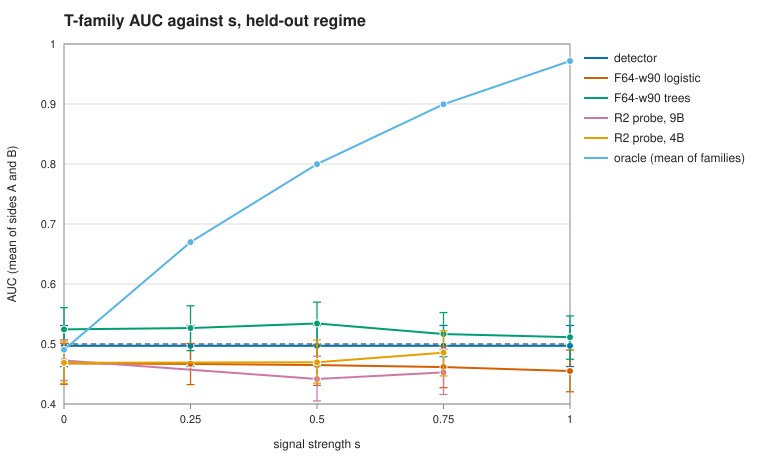

# Result (M7, 2026-10-22)

SPEC §10 M7, written after the kill gate G2 failed (§7.1). Generator `tt-gen-v1` (sha256
`a25222f6…`), render `raw-v1`, prompt `m4-v1` (`0cfe33a7…`). Models: Qwen 3.5 9B MLX 4-bit
@ `938d891` and 4B @ `32f3e8e`. The claims are method-level only, with no realism claim (SPEC §2–3).

## The result, in SPEC §2's form

> On a synthetic testbed with declared mechanisms, at signal strength *s* = 0.75, on these *k* = 4
> held-out abuse families whose evidence is timeline-only (pairs 2, 3, 4, 6), a linear probe on
> Qwen 3.5 9B (R2) reaches AUC 0.453 [0.42, 0.49] (4B: 0.486 [0.45, 0.52]), against 0.517
> [0.48, 0.55] for the stronger of two models over the predecessor's 64 features (boosted trees) and
> 0.497 [0.46, 0.53] for the frozen detector.

The oracle bound is 0.90. G2 failed as pre-registered: neither model's paired lower bound over either
F64 model is above 0, and both pass the *s* = 0 control (`reports/M4-probe.md`). This is a null:
**on families it wasn't trained on, a probe on a small local LLM adds nothing over features, even
when the signal is only in the timeline.** The project's headline is **null, except one
timeline-only mechanism a hosted model reads without training on it**: Claude Haiku 5.5 few-shot
ranks pair 3 at 0.758 [0.679, 0.832] on fresh worlds, where both F64 models are at chance
(M9, pre-registered; addendum below).

## Figure: T-family AUC against *s*, held-out regime (`RESULT-auc-vs-s.svg`)

| Held-out primary (mean of sides A, B) | s = 0 | 0.25 | 0.5 | 0.75 | 1 |
|---|---|---|---|---|---|
| detector | 0.497 | 0.497 | 0.497 | 0.497 | 0.497 |
| F64-w90 logistic | 0.468 | 0.467 | 0.465 | 0.462 | 0.455 |
| F64-w90 trees | 0.524 | 0.527 | 0.534 | 0.517 | 0.511 |
| R2 probe, 9B | 0.472 | | 0.442 | 0.453 | |
| R2 probe, 4B | 0.469 | | 0.470 | 0.486 | |
| oracle bound | 0.49 | 0.67 | 0.80 | 0.90 | 0.97 |

Each 95% group-bootstrap interval is ±0.035 to ±0.04 (exact values in the M2 and M4 reports). R2 was
embedded at *s* ∈ {0, 0.5, 0.75}: the gate's two values and the secondary.

## Per family and channel, *s* = 0.75 (in-family / held-out)

| | 1 (M) | 2 (T) | 3 (T) | 4 (T) | 5 (F) | 6 (T) |
|---|---|---|---|---|---|---|
| F64-w90 trees | 0.94 / 0.65 | 0.54 / 0.53 | 0.58 / 0.54 | 0.50 / 0.50 | 0.91 / 0.63 | 0.45 / 0.50 |
| R2 probe, 9B | 0.94 / 0.65 | 0.56 / 0.46 | 0.94 / 0.41 | 0.47 / 0.44 | 0.88 / 0.67 | 0.82 / 0.42 |
| R2 probe, 4B | 0.94 / 0.58 | 0.55 / 0.45 | 0.94 / 0.47 | 0.40 / 0.44 | 0.88 / 0.61 | 0.85 / 0.55 |
| oracle bound | 0.91 | 0.85 | 0.99 | 0.90 | 0.96 | 0.86 |

Pairs: 1 rotator, 2 parallel farm, 3 template operator, 4 single budget, 5 aged expansion, 6 serial
operator, each against its legitimate twin. On the M and F channels (pairs 1 and 5), R2 is level with
F64 in-family (0.88–0.94, against 0.86–0.94 for logistic and trees) and a little below it held-out
(0.58–0.67, against 0.63–0.74).

## The three questions (SPEC §2)

- **Q1, held-out (the claim's form): no.** *In-family (reported, not claimed):* trained on the same
  family, R2 sees timeline-only evidence that F64 can't. It reaches 0.725 (9B) and 0.706 (4B) at
  *s* = 0.75, against 0.517 for trees, and 0.625 and 0.612 at *s* = 0.5. The *s* = 0 control is at
  chance (0.46). The evidence is in the embeddings for pairs 3 and 6, near their oracles; pairs 2 and 4
  aren't seen in either regime.
- **Q2, fine-tuning against zero-shot and the probe: not answered.** G2 stopped the line before R3
  (LoRA, M5). R1 (zero-shot) wasn't run: it can't rescue a failed gate (owner, 2026-10-22).
- **Q3, transfer to unseen mechanisms: no, for the probe.** Held-out, R2 scores 0.41–0.55 on every
  T family. Whatever it learns is specific to each mechanism, not a shared "one operator" signal
  (an interpretation, not a tested claim).

## Addendum: M8, Claude Haiku 5.5 (2026-10-22)

A hosted reference point after a pivot, not SPEC §2's small local model, and no rescue of G2. On
the 320 T units of `m1-dev-s0.75-seed1`, held-out, the pilot is **NO-GO** as pre-registered
(`prereg/M8.md`). Zero-shot reaches 0.561 (bound 0.487) and few-shot 0.553 (0.479), against 0.517
for F64 trees; neither difference over trees excludes 0. Pair 3 alone stands out (few-shot 0.84
[0.74, 0.92], zero-shot 0.68, trees 0.56). That subgroup is post hoc, on a gate world, with no
*s* = 0 control, so it is reported, not claimed (`reports/M8.md`). M9 tested it (below).

## Addendum: M9, pair 3 confirmed (2026-10-30)

A pivot to one pre-specified hypothesis (`prereg/M9.md`, frozen before any world or call), on three
fresh worlds: two at *s* = 0.75 (80 abusive + 80 legitimate pair 3 groups) and an *s* = 0 control
(40 + 40). Same prompt, examples (pairs 4–6 only) and route as M8; 1,200 calls, all parsed.
**CONFIRMED**: few-shot 0.758 [0.679, 0.832]; over F64 logistic (0.511) +0.246 [0.129, 0.357] and
over trees (0.502) +0.256 [0.136, 0.364]; control 0.571 [0.445, 0.697], containing 0.5. Each world
clears 0.5 alone (0.80, 0.72). Zero-shot (0.577, not gating) doesn't beat F64. It covers one
family, from a hosted model rather than SPEC §2's, and the small control rules out only a large
artifact (`reports/M9.md`).

## Limits

- One model series (4-bit MLX), one prompt, one probe: L2 logistic on the layer-16 mean, selected on
  one tuning world where every candidate was near chance held-out (0.46–0.55). The 9B's C is at the
  grid's edge, kept under the no-re-tuning rule.
- Two worlds per *s* (320 abusive T groups). The sweep is paired across *s*, so chance structure
  repeats; F64 logistic and R2 sit below 0.5 at *s* = 0 on these draws.
- Each training side holds only two T families, so held-out transfer is a demanding test by design.
- The in-family finding comes from development worlds that have already been seen. Making it a claim
  needs a pivot note, a new prereg and fresh worlds.

## Not done, by the gate

M5 (R3, G3) and M6 (the `runs/confirm-*` worlds stay unopened); R1 and Nimble; the Tier 4 transfer
check (default no; only if G3 passed). Sources: `runs/m2-r0/r0.json` (`4f3f2ddc…`),
`runs/m4-g2/g2.json` (`b23f922c…`), `runs/m4-g2/report.json` (`2bec71b0…`),
`runs/m4-r2-s0.5/r2.json` (`00ac6cb8…`), `runs/m8-pilot/scored/report.json` (`d9888902…`),
`runs/m9-confirm/scored/report.json` (`f533434d…`). Figure: `python -m testbed.eval.result --r0
runs/m2-r0/r0.json --r2 runs/m4-g2/report.json runs/m4-r2-s0.5/r2.json --out
reports/RESULT-auc-vs-s.svg`.
